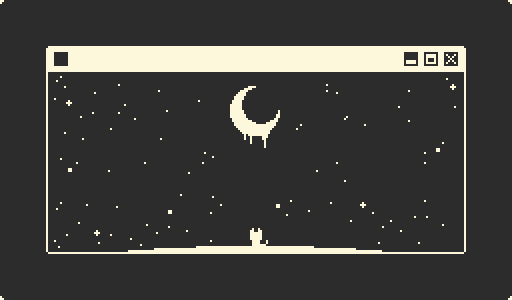

<div align="center">
  
  
</div>

<div align="center">
  <h2>MD. Anikur Rahman</h2>
  <a href="https://github.com/anik889">
    
  </a>
</div>

---

<br/>

CS undergrad by day, competitive programmer by passion. I live for the moment a hard problem clicks — when the noise clears, the structure reveals itself, and the solution writes itself cleanly. That feeling is what keeps me going.

Beyond contests, I care deeply about software engineering and building things that actually work and feel considered. But the long game is research — understanding CS well enough to contribute to it, and publishing work that moves the field forward.

```
  currently  →  BSc CSE · Green University of Bangladesh
  competing  →  Codeforces · AtCoder · CodeChef · GUBCPC
  building   →  full-stack web projects · CP solution archive
  goal       →  researcher · published author · strong engineer
```

<br/>

---

### Competitive Programming

I've competed nationally and internationally — the pressure of timed contests is where I've sharpened most of my thinking.

<br/>

| &nbsp; | Contest | Platform | Level |
|:---:|:---|:---|:---:|
| 🏆 | National High School Programming Contest | NHSPC | 🇧🇩 National |
| 🌍 | Hacker Cup | Meta / Facebook | Global |
| ⚔️ | Smackdown | CodeChef | Global |
| 🔁 | Rated Rounds | Codeforces | Ongoing |
| 🌸 | Regular Contests | AtCoder | Ongoing |
| 🏫 | Club Contests & Marathons | GUBCPC | University |

<div align="center">
  <br/>
  
  &nbsp;
  <a href="https://codeforces.com/profile/anik889">
    
  </a>
</div>

<br/>

---

### Tech Stack

<div align="center">

<div>
  <div style="display:flex;align-items:center;margin-bottom:10px">
    <span style="width:120px;font-weight:600">Languages</span>
    &nbsp;
    &nbsp;
    &nbsp;
    &nbsp;
    
  </div>
  <div style="display:flex;align-items:center;margin-bottom:10px">
    <span style="width:120px;font-weight:600">Web</span>
    &nbsp;
    &nbsp;
    
  </div>
  <div style="display:flex;align-items:center;margin-bottom:10px">
    <span style="width:120px;font-weight:600">Databases</span>
    &nbsp;
    &nbsp;
    
  </div>
  <div style="display:flex;align-items:center">
    <span style="width:120px;font-weight:600">Tools</span>
    &nbsp;
    &nbsp;
    
  </div>
</div>

</div>

<br/>

---
### Work

Competitive programming archives, web projects, and experiments — an honest record of where I've been and what I've built.

| Repo | Description |
|:---|:---|
| 📁 [Codeforces-Solution](https://github.com/anik889/Codeforces-Solution) | Accepted solutions from Codeforces rated rounds |
| 📁 [GREEN-OJ-Problem-Solving](https://github.com/anik889/GREEN-OJ-Problem-Solving) | Solutions from Green University OJ contests |
| 📁 [GUBCPC-Marathon](https://github.com/anik889/GUBCPC-Marathon) | GUBCPC club marathon solutions |
| 📁 [NOOBfolio-V-2.0.1](https://github.com/anik889/NOOBfolio-V-2.0.1) | Personal portfolio — TypeScript |
| 📁 [CSE-Course-Based-Problem](https://github.com/anik889/CSE-Course-Based-Problem) | Coursework problems solved in C |
| 📁 [flappy-bird](https://github.com/anik889/flappy-bird) | Browser game — HTML/CSS/JS |

<br/>

---

### GitHub Stats

<div align="center">
  
  &nbsp;&nbsp;
  
</div>

---

### Contribution Activity

<div align="center">
  
</div>

<br/>

---

### Connect

<div align="center">

  <a href="https://codeforces.com/profile/anik889">
    
  </a>
  &nbsp;
  <a href="https://www.codechef.com/users/anik889">
    
  </a>
  &nbsp;
  <a href="https://atcoder.jp/users/anik889">
    
  </a>
  &nbsp;
  <a href="https://anik889.github.io/NOOBfolio-V-2.0.1/">
    
  </a>
  &nbsp;
  <a href="https://github.com/anik889">
    
  </a>

</div>

<br/>

<div align="center">
  
</div>
